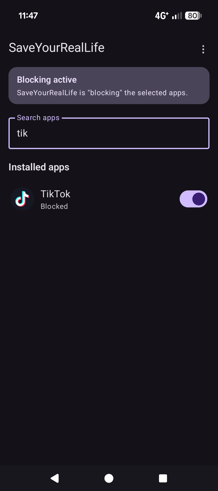
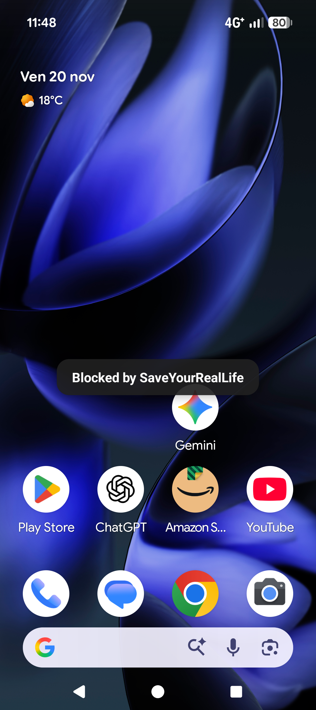

# SaveYourRealLife

A personal Android project born from my need to reduce compulsive scrolling
and the time I spent opening apps out of habit.

Select the apps you want to block, and SaveYourRealLife returns you to the
Home screen whenever you open them. You can turn blocking off when you
want to use an app intentionally, then turn it back on.

## Screenshots

<p>
  
  
</p>


## Features

- Choose which apps to block.
- Search the installed app list.
- Save your app selection locally.
- Return to the Home screen with a brief blocking message.
- Switch between Italian and English.
- Choose a light or dark theme.
- Open Android's Accessibility settings from the in-app activation guide.
- Turn off the accessibility service directly from the app settings.

## Installation and setup

1. Download the APK from [GitHub Releases](https://github.com/BarbaRossiccia/SaveYourRealLife/releases).
2. Install and open SaveYourRealLife.
3. Follow the in-app activation popup to open Android's Accessibility settings.
4. Enable the SaveYourRealLife accessibility service and confirm Android's prompt.
5. Return to the app and select the apps you want to block.

To unblock an individual app, turn off its switch in SaveYourRealLife.
To stop all blocking, turn off the accessibility service from the app settings.

The APK distributed through GitHub Releases is a debug build intended
for personal use.

### If activation is restricted

On my Pixel 9a, I currently enable the service through the in-app
activation guide. Other devices or Android versions may require
an additional step.

If Android prevents activation because of restricted settings, open
Settings → Apps → SaveYourRealLife → ⋮ → Allow restricted settings,
then follow the activation guide again. Menu names may vary.

## How it works

SaveYourRealLife uses an Android accessibility service to receive
window-change events and check whether the app being opened is
in your saved block list.

When a selected app opens, the service requests a return to the Home
screen and displays a brief blocking message. The selected app remains
in the background.

App selections and preferences are stored locally using Jetpack DataStore.
Root access is not required.

## Limitations 

Blocking depends on the accessibility service being enabled.
You can unblock individual apps or turn off the service at any time.

Selected apps are sent to the background and may retain their previous
state. The app is intended to help interrupt habitual use, and blocking
remains under your control.

On my Pixel 9a, Android has occasionally shown a notification warning
about the app's behavior while blocking other apps. The exact notification
text has not yet been recorded.

### Testing

Manually tested on a Pixel 9a, including ten consecutive rapid reopening
attempts after the blocking fix. Each attempt returned to the Home screen.

The project includes four unit tests written by Codex, covering app
eligibility and blocking-event handling. All four tests passed, and
the debug build completed successfully during verification of the fix.

## Build from source

### Requirements

- Android Studio with support for Android Gradle Plugin 9.2.1.
- JDK 21 for the Gradle daemon.
- Android SDK Platform 36.1.
- Internet access for the initial download of Gradle and dependencies.

Clone the repository and open its root folder in Android Studio.
Let Gradle sync complete and install any required SDK components.

From the project root, run the unit tests and build the debug APK:

```bash
./gradlew :app:testDebugUnitTest :app:assembleDebug
```

The generated APK is available at:

```text
app/build/outputs/apk/debug/app-debug.apk
```

To install and run the app from Android Studio, select an emulator or
a connected Android device and click Run.

## Development and contributions

I started SaveYourRealLife to address a personal need. I defined the
desired behavior, provided feedback, and tested the app on my Pixel 9a.

The application code and unit tests were generated by OpenAI Codex.
Codex also proposed the mechanism of returning to the Home screen
when a selected app opens.

Through this project, I am learning about the app's architecture,
Android Studio, debugging, Git, and project documentation.
ChatGPT also helped me understand the blocking logic and prepare this README.

Bug reports, feedback, and suggestions are welcome through GitHub Issues.

## License

This project is licensed under the [Zero-Clause BSD license (0BSD)](LICENSE).

Third-party dependencies remain under their respective licenses.
